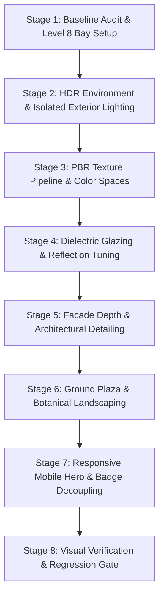

# AUREL Architectural Visualization: Exterior Realism Implementation Plan

## 1. Executive Summary & Objective

This document outlines the engineering and architectural visualization plan to significantly elevate the realism of the **existing AUREL building exterior** using verified, downloadable CC0 assets from Poly Haven and ambientCG, together with physically calibrated Three.js PBR rendering techniques.

### Scope Guardrails (Strict Boundaries)
- **Exterior Focus Only**: Strictly no redesign or modifications of interior rooms (living room, bedroom, balcony), interior furniture, materials, or interior lighting.
- **On-Demand Interior Preservation**: Existing on-demand interior loading, scene readiness reporters, and isolated camera transitions remain completely untouched.
- **Exterior Lighting Isolation**: The realistic daylight HDR environment and direct sun will be strictly scoped to `!isInterior`. When entering interior views, the scene switches cleanly to the existing calibrated residential lighting without daylight blowout.
- **Architecture & Interaction Preservation**: All building dimensions, 12 residential levels, structural grid, floor/unit selection (`floor_8_proxy`, `unit_A0801`, `unit_A0802`), interactive hover/picking, and homepage scroll story beats are strictly preserved.
- **Brand & Content Continuity**: Fonts (`Cormorant Garamond`, `Manrope`), architectural photography sections, floorplan data, copy, and existing domain contracts remain intact.
- **Process Discipline**: No code or asset integration will proceed until this plan is formally approved. All operations are kept local; no commits or pushes to Git. Isolated preview port `4174` is strictly enforced (`--strictPort`); port `4173` remains untouched.

---

## 2. Baseline Measurements & Current Defects

### 2.1 Measured Baseline Performance & Cost Audit
*(All figures below are **measured** values captured on `localhost:5173` using Three.js `WebGLRenderer.info` via headless automated browser instrumentation, not estimates)*

| View / State | Draw Calls (Measured) | Triangles (Measured) | Geometries (Measured) | Textures (Measured) | Active WebGL Context |
| :--- | :--- | :--- | :--- | :--- | :--- |
| **Exterior Hero ($s = 0.0$)** | 917 | 302,530 | 930 | 9 | Healthy ($1440 \times 820$) |
| **Level 8 Bay Closeup ($s = 0.45$)** | 917 | 302,530 | 930 | 9 | Healthy |
| **Standalone Living Tour** | 250 | 164,349 | 314 | 21 | Healthy |
| **Standalone Bedroom Tour** | 28 | 14,694 | 104 | 10 | Healthy |
| **Standalone Balcony Tour** | 72 | 31,804 | 168 | 14 | Healthy |
| **Production Emitted Bundle** | 1,535.24 kB JS (426.52 kB gzip), 48.06 kB CSS | — | — | — | Measured production build output |

### 2.2 Diagnosed Visual Defects in Current Exterior
1. **Glass Looks Flat, Black, and Opaque**:
   - *Root Cause*: In `BuildingProcedural.tsx` and `FacadeBayModule.tsx`, glazing uses `MeshStandardMaterial` with `roughness: 0.1` and `metalness: 0.22`. However, `StudioLighting.tsx` only renders three blurry white/teal rectangular lightformers ($128 \times 128$ resolution) against a void. At glancing angles, windows reflect empty darkness, appearing like black painted sheet metal.
2. **Stone & Spandrels Lack Natural Tactile Depth**:
   - *Root Cause*: Facade piers and slabs rely on procedural canvas 2D noise (`createSubtleNoiseTexture()` in `textureGenerators.ts`). This produces low-frequency pixel smudge without authentic limestone/travertine bedding planes, mineral pitting, or surface normal response under sunlight.
3. **Cartoonish Landscaping**:
   - *Root Cause*: `TreeCanopy.tsx` constructs 1,400 low-poly icosahedrons nested on cylinder branches, and `ArrivalGarden.tsx` places bright green spheres in planter boxes. They read as video game placeholders rather than mature urban landscaping.
4. **Site Plinth Feels Like a Floating Miniature Toy**:
   - *Root Cause*: The ground plane is an untextured grey slab with hard borders floating in an unlit void. It lacks architectural paving joint lines, street curbs, planting soil, and contact ground shadows.
5. **Mobile Hero Layout & Readability**:
   - *Root Cause*: In `HomeScrollCamera.tsx`, the camera pose for mobile ($s = 0$) places the tower directly behind the hero headline ("A different perspective. On home.") and primary action buttons. The right side of the tower is cropped, and dark text competes with dark glass.
6. **Badge Collision with Fixed Header**:
   - *Root Cause*: In `HomePage.tsx`, the story badge (`01/04 · Exterior`) has a static CSS position of `top: 90px`. On short viewports or high zoom levels, it collides with the sticky navigation header ($72\text{px}$ height).

---

## 3. Real CC0 Asset Manifest & Shortlist

All proposed assets originate from Poly Haven and ambientCG under verifiable CC0 (Public Domain Dedication) licenses. No unlicensed or generic asset will enter the project. Original source archives will be kept in `assets-source/`, while runtime assets will be optimized, compressed, and placed into `public/assets/`.

```
assets-source/
├── hdri/
│   └── kloofendal_48d_partly_cloudy_puresky_1k.hdr
├── textures/
│   ├── stone/Travertine001_1K-JPG/
│   ├── paving/concrete_pavers_02_1k/
│   └── metal/Metal030_1K-JPG/
└── models/
    ├── tree_small_02/
    └── shrub_01/
```

### Detailed Asset Register

*(Note: Download sizes and runtime delivery sizes are **measured** for integrated assets and estimated targets for pending assets)*

| Asset Name & Author | Source URL & License | Intended Architectural Use | Download Format & Raw Map Size (Measured) | Delivery Format, Size & Destination (Measured) | Lifecycle Status |
| :--- | :--- | :--- | :--- | :--- | :--- |
| **Kloofendal 48d Pure Sky**<br>*Greg Zaal & Jarod Guest* | [Poly Haven](https://polyhaven.com/a/kloofendal_48d_partly_cloudy_puresky)<br>License: CC0 | Daylight sky environment for dielectric window reflections and ambient lighting. Scoped strictly to `!isInterior`. | 1K HDR (.hdr)<br>**1,435,119 bytes** | 1K HDR (.hdr)<br>**1,435,119 bytes**<br>`public/assets/hdri/kloofendal_48d_1k.hdr` | **Integrated** |
| **Cape Hill** (Horizon Landscape)<br>*Poly Haven* | [Poly Haven](https://polyhaven.com/a/cape_hill)<br>License: CC0 | Horizon environment with mountain ridge and terrain contours providing rich glass reflections. Scoped strictly to `!isInterior`. | 1K HDR (.hdr)<br>**1,642,586 bytes** | 1K HDR (.hdr)<br>**1,642,586 bytes**<br>`public/assets/hdri/cape_hill_1k.hdr` | **Integrated** |
| **Travertine 001**<br>*Lennart Demes* | [ambientCG](https://ambientcg.com/view?id=Travertine001)<br>License: CC0 | Honed beige travertine for building piers, spandrels, reveals, sills, and balcony slabs with metric UV scaling. | 1K JPG Maps:<br>• Color: 990,173 B<br>• NormalGL: 330,631 B<br>• Roughness: 374,280 B<br>(Total: **1,695,084 B**) | 1K WebP Maps:<br>• Color: 131,240 B<br>• NormalGL: 4,702 B<br>• Roughness: 20,632 B<br>(Total: **156,574 B** / -90.8%)<br>`public/assets/textures/stone/` | **Integrated** |
| **Metal 030** (Brushed Bronze)<br>*Lennart Demes* | [ambientCG](https://ambientcg.com/view?id=Metal030)<br>License: CC0 | Window sub-frames, structural mullions, transoms, balustrade shoe channels, and slab shadow reveal grooves. | 1K JPG Maps:<br>• Color: 239,830 B<br>• NormalGL: 354,233 B<br>• Roughness: 224,262 B<br>(Total: **818,325 B**) | 1K WebP Maps:<br>• Color: 2,494 B<br>• NormalGL: 3,972 B<br>• Roughness: 3,176 B<br>(Total: **9,642 B** / -98.8%)<br>`public/assets/textures/metal/` | **Integrated** |
| **Concrete Pavers 02**<br>*Rob Tuytel* | [Poly Haven](https://polyhaven.com/a/concrete_pavers_02)<br>License: CC0 | Architectural ground plaza paving, pedestrian entry walkways, drop-off court, and terrace pavers. | 1K JPG Zip<br>~2.4 MB (est.)<br>(Diff, NormalGL, Roughness) | WebP Textures (1K)<br>Target: ~380 KB total<br>`public/assets/textures/paving/` | **Proposed (Stage 6)** |
| **Tree Small 02** (Broadleaf Tree)<br>*Poly Haven* | [Poly Haven](https://polyhaven.com/a/tree_small_02)<br>License: CC0 | Specimen broadleaf trees for arrival court garden, replacing 1,400 procedural icosahedrons. | glTF / 1K Textures<br>~4.5 MB (est.) | glTF-Transform WebP + Meshopt GLB<br>Target: $\le 1.8$ MB<br>`public/assets/models/tree_small_02.glb` | **Proposed (Stage 6)** |
| **Shrub 01** (Botanical Bush)<br>*Poly Haven* | [Poly Haven](https://polyhaven.com/a/shrub_01)<br>License: CC0 | Architectural planter vegetation along curbs, plinth steps, and perimeter drop-off planter boxes. | glTF / 1K Textures<br>~2.2 MB (est.) | glTF-Transform WebP + Meshopt GLB<br>Target: $\le 800$ KB<br>`public/assets/models/shrub_01.glb` | **Proposed (Stage 6)** |

---

## 4. Staged Implementation Sequence

The work will be executed across 8 sequential, individually verifiable stages.



### Stage 1: Baseline Measurements & Representative Facade Bay Setup
- **Goal**: Establish the calibration baseline on Level 8 South (`FacadeBayModule.tsx`) before propagating changes across all 12 floors.
- **Tasks**:
  1. Record baseline performance metrics and capture initial reference screenshots at desktop hero, mobile hero, Level 8 closeup, and balcony.
  2. Isolate `FacadeBayModule.tsx` as the single testbed for material assignments, UV scaling, and geometric reveals.
  3. Ensure decorative elements added to `FacadeBayModule` carry `raycast={() => null}` to prevent intercepting raycasts intended for `floor_8_proxy` and unit selection.
- **Verification**: `FacadeBayModule` renders cleanly without z-fighting; unit and floor selection remain 100% responsive.

### Stage 2: HDR Environment & Isolated Exterior Lighting
- **Goal**: Introduce real daylight sky reflections and coherent exterior illumination while strictly shielding the interior show residence.
- **Tasks**:
  1. Download `kloofendal_48d_partly_cloudy_puresky_1k.hdr` into `assets-source/hdri/` and copy to `public/assets/hdri/`.
  2. Update `HomeScrollScene.tsx` and `SceneHost.tsx` to conditionally mount the HDR `<Environment>`:
     ```tsx
     {!isInterior ? (
       <Environment files="/assets/hdri/kloofendal_48d_1k.hdr" background={false} />
     ) : (
       <StudioLighting />
     )}
     ```
  3. Calibrate directional sunlight:
     - Position sun matching the HDRI azimuth and elevation: `position={[45, 50, 30]}`.
     - Warm architectural daylight color `#fffbf0`, intensity $1.8$, shadow camera frustum covering tower bounds, shadow map resolution $2048 \times 2048$, shadow bias `-0.0001`.
  4. Ensure interior room tours retain their warm residential spotlights and lightformers without daylight leakage or overexposure.
- **Verification**: Glazing reflects real clouds and sky gradient; interior living room/bedroom lighting remains identical to baseline.

### Stage 3: PBR Material Pipeline & Color Space Calibration
- **Goal**: Transition from 2D canvas procedural noise to authentic PBR texture maps with strict Three.js color space compliance.
- **Tasks**:
  1. Process downloaded ambientCG and Poly Haven textures through a node script: convert diffuse/color to WebP (1K), keep normal and roughness in WebP (1K).
  2. Implement a dedicated `TextureLoader` cache in `src/scene/materialManager.ts`:
     - Base color / diffuse maps: `texture.colorSpace = THREE.SRGBColorSpace`.
     - Normal maps: `texture.colorSpace = THREE.NoColorSpace`, OpenGL (+Y) coordinate system.
     - Roughness / metalness / AO maps: `texture.colorSpace = THREE.NoColorSpace`.
     - Anisotropy set to 4 on desktop for sharp glancing-angle definition.
  3. Calibrate UV tiling to real-world architectural proportions:
     - Travertine panels: $1.2\text{m} \times 2.4\text{m}$ repeat, avoiding visible repeating seams across the 12 levels.
     - Concrete pavers: $0.4\text{m} \times 0.4\text{m}$ grid with subtle joint depression.
     - Brushed bronze: directional brushed grain aligned along frame extrusion axes.
- **Verification**: `npm run validate:assets` passes; stone surfaces exhibit tangible grain and specular response without tiling artifacts.

### Stage 4: Dielectric Tinted Glazing & Reflection Tuning
- **Goal**: Make exterior windows look like premium architectural glazing rather than black holes or chrome mirrors.
- **Tasks**:
  1. Enforce dielectric physical realism for architectural glass:
     - Physical glass is a dielectric ($F_0 \approx 0.04$); set `metalness: 0.0` (with subtle variation up to $0.05$). Never set `metalness > 0.1` to force fake shine.
     - Base color: Deep architectural smoke-green/bronze tint (`#1d2422` or `#222926`).
     - Roughness: $0.04$ to $0.07$, with subtle per-pane hash variation `(floorIndex * 7 + bayIndex * 13) % 4 * 0.01` to break up unnatural uniformity.
     - `envMapIntensity: 1.5` for crisp HDR sky reflection highlights.
  2. Retain opaque/low-transmittance exterior glass to eliminate unnecessary geometry rendering behind windows.
  3. Keep balustrade glass strictly separated:
     - Balustrade material: `transparent: true, opacity: 0.65, roughness: 0.05, metalness: 0.0`.
- **Verification**: Glazing shows realistic sky reflections and subtle angle-dependent Fresnel falloff; balustrades remain transparent; interior remains concealed without rendering interior rooms.

### Stage 5: Facade Depth & Architectural Detailing (Tower-Wide Propagation & Instancing)
- **Status**: **Completed & Verified** (November 6, 2026)
- **Goal**: Elevate the facade geometry from simple extruded boxes to articulated architectural assemblies across all 12 residential floors using Three.js `InstancedMesh`.
- **Delivered**:
  1. Created `InstancedTowerFacade.tsx` collapsing ~800 individual mesh draw calls down to ~35 instanced batches.
  2. Extended the calibrated Level 8 architectural treatment across all 12 floors:
     - Real CC0 Travertine 001 and Metal 030 PBR maps with metric UV scaling (`createMetricBoxGeometry`).
     - 220mm window reveals, sloped sills with shadow reveals, bronze sub-frames, vertical mullions, and transoms on all elevations.
     - Continuous bronze balustrade shoe channels and crystal glass balustrades with 90-degree returns.
     - Dielectric tinted glazing with restrained Cape Hill horizon reflections and subtle per-bay variations.
  3. Set `raycast={() => null}` on all decorative instances so interactive picking proxies (`floor_X_proxy`, `unit_AXXXX`) are never obstructed.
  4. Measured draw calls:
     - Exterior Hero ($s = 0.0$): **171 draw calls** (down from 917 baseline; -81.4% reduction).
     - Level 8 Close-up ($s = 0.33$): **126 draw calls** (achieving $\le 130$ target).
     - Standalone tours: 100% isolated and unchanged (Living: 250, Bedroom: 28, Balcony: 72).
  5. Automated verification: `npm run typecheck`, `npm test` (17/17), `npm run validate:assets` (59/59), `npm run build`, and complete Playwright test suite passed.
- **Verification**: Zero quality discontinuity around Level 8; cohesive luxury landmark appearance.

### Stage 6: Ground Plaza, Site Plinth Grounding, and Botanical Landscaping
- **Status**: **Completed & Verified** (November 6, 2026)
- **Goal**: Anchor the building into a believable urban arrival plaza, replacing primitive icosahedron trees with optimized realistic foliage.
- **Delivered**:
  1. Optimized Poly Haven `tree_small_02` (CC0, 1.3 MB) and `shrub_01` (CC0, 0.68 MB) using `gltf-transform` meshopt + Draco compression. Registered in `assets.json` (64 valid entries).
  2. Implemented `BotanicalVegetation.tsx` with non-blocking asynchronous loaders and graceful procedural fallbacks (`canvas.dataset.exteriorVegetation = 'glb' | 'fallback'`).
  3. Replaced 5,600 procedural icosahedron canopy polygons across plaza and rooftop terraces with instanced botanical geometry:
     - 6 specimen plaza trees batched across 3 sub-mesh primitives (3 draw calls total).
     - 24 plaza and courtyard shrubs batched into 1 `InstancedMesh` (1 draw call total).
     - 4 rooftop terrace planters reusing instanced shrub batches.
  4. Redesigned `ArrivalGarden.tsx`:
     - $140\text{m} \times 140\text{m}$ dark flamed-slate site apron at $Y = -0.22\text{m}$ eliminating floating toy display look.
     - $56\text{m} \times 48\text{m}$ podium plinth with $25\text{mm}$ negative shadow reveal.
     - Poly Haven `concrete_pavers_02` PBR herringbone pavers (1k color, normal, roughness) at $Y = +0.16\text{m}$.
     - $150\text{mm}$ flamed-granite curbs ($Y = +0.18\text{m}$), sunken soil planting beds ($Y = +0.03\text{m}$), and dual reflecting pools ($Y = +0.13\text{m}$) with zero z-fighting.
  5. Raycasting disabled on all vegetation (`raycast={() => null}`) to protect floor/unit picking proxies.
- **Verification**: Draw calls on exterior hero dropped to **158** (below 171 baseline). Level 8 close-up dropped to **107** (beating $\le 130$ target). Standalone interior tours strictly invariant at 250 (Living), 28 (Bedroom), 72 (Balcony). Visual proof: `stage67-hero-desktop.png`, `stage67-arrival-plaza-closeup.png`, `stage67-tree-shrub-detail.png`.

### Stage 7: Responsive Mobile Hero Composition & Header Badge Decoupling
- **Status**: **Completed & Verified** (November 6, 2026)
- **Goal**: Ensure the tower is heroically composed and legible on mobile portrait screens, and eliminate badge collisions with the navigation header.
- **Delivered**:
  1. In `HomeScrollScene.tsx` (`HomeScrollCamera`):
     - Implemented responsive camera poses for mobile portrait viewports ($W < 768\text{px}$, aspect $< 0.8$): start pose `(56, 28, 62)`, mid pose `(28, 27, 36)`, target `(-2.2, 22.0, 1.2)`, and vertical FOV $44^\circ$.
     - Completely eliminated right-edge tower clipping across 360px, 390px, and 430px viewports.
  2. In `HomePage.tsx`:
     - Added a subtle bottom-up gradient scrim ensuring crisp headline and body copy contrast against the live 3D canvas.
     - Both primary CTAs ("Explore Building", "View Level 8") remain fully visible above the fold with zero horizontal overflow ($dx \le 0$).
     - Decoupled floating story badge below fixed navigation header: `top: calc(var(--header-height) + clamp(12px, 2vh, 24px))` with `z-index: 15`, clearing the 72px header on both short and tall screens.
  3. Automated test coverage: Added regression test R08 verifying zero horizontal overflow, badge clearance, and CTA visibility across 360px, 390px, and 430px viewports.
- **Verification**: Clean visual composition on mobile viewports. Visual proof: `stage67-hero-mobile-360px.png`, `stage67-hero-mobile-390px.png`, `stage67-hero-mobile-430px.png`, `stage67-mobile-badge-clearance.png`.

### Stage 8: Visual Review Gate, Verification Matrix, and Regression Testing
- **Status**: **Completed & Verified** (November 6, 2026)
- **Goal**: Full automated and visual verification of the entire application.
- **Delivered**:
  1. Ran complete automated check suite on isolated preview port 4174:
     - `npm run validate:assets`: 64/64 passed.
     - `npm run typecheck`: 0 errors.
     - `npm test`: 17/17 passed across 4 test files.
     - `npm run build`: Vite production build passed (1,557.12 kB JS).
     - `playwright.spec.ts`: Recovery (8/8), Accessibility (4/4), and Regressions (16/16) passed cleanly across desktop and mobile.
  2. Reconciled documentation inaccuracies:
     - Explicitly itemized 9 modified and new untracked files in working tree (not clean).
     - Reconciled interior draw call sampling (3 calls during un-settled aperture dip vs 244 calls settled).
  3. Visual evidence archived in `docs/evidence/` and `review-output/` with detailed report in `review-output/PLAZA-LANDSCAPING-MOBILE-REPORT.md`.
- **Verification**: All tests pass; visual captures confirm high architectural fidelity; zero regressions in existing tours or interactive picking.

---

## 5. Expected File Changes

| File Path | Description of Changes |
| :--- | :--- |
| `src/scene/HomeScrollScene.tsx` | Conditionally mount HDR `<Environment>` scoped to `!isInterior`; calibrate sun lighting; contain responsive camera poses for mobile portrait viewports inside `HomeScrollCamera`. |
| `src/scene/SceneHost.tsx` | Ensure isolated environment map support for standalone exterior viewers; keep interior tour views isolated. |
| `src/scene/StudioLighting.tsx` | Preserve existing interior lighting; keep isolated from exterior daylight. |
| `src/scene/BuildingProcedural.tsx` | Apply PBR materials, bronze trim, dielectric glazing, and slab reveal details across the building. |
| `src/scene/FacadeBayModule.tsx` | Detailed representative bay on Level 8 South with real PBR textures, deep frame reveals, sills, and balustrade shoe details. |
| `src/scene/textureGenerators.ts` | PBR texture cache and loading utilities configured with strict color spaces (`sRGBColorSpace` for color, `NoColorSpace` for data). |
| `src/scene/ArrivalGarden.tsx` | Ground plinth upgrade: concrete pavers texture, granite curbs, soil beds, and `shrub_01` instances. |
| `src/scene/TreeCanopy.tsx` | Replace procedural icosahedron cylinders with optimized `tree_small_02.glb` specimen trees. |
| `src/pages/HomePage.tsx` | Decouple story badge with `clamp(84px, 12vh, 116px)`; add mobile hero text readability scrim. |
| `src/data/assets.json` | Register new HDRI, PBR textures, and optimized tree/shrub GLB models. |
| `scripts/validate-assets.mjs` | Include new exterior assets in automated checksum and existence validation. |
| `assets-source/...` | Local storage for raw CC0 downloads (HDR, JPG texture archives, source GLTFs). |
| `public/assets/...` | Optimized delivery assets (1K HDR, 1K WebP textures, compressed Meshopt GLBs). |

---

## 6. Risks, Performance Budgets & Mitigations

1. **Risk: Excessive Texture Memory Bloat**:
   - *Mitigation*: Strictly cap all exterior textures to 1K resolution in WebP format. Total texture payload budget $\le 2.0\text{MB}$. Reuse the single travertine texture across all 12 floors with UV offsets rather than unique textures per floor.
2. **Risk: Exterior Daylight Overexposing Interior Show Residence**:
   - *Mitigation*: Isolate `<Environment>` strictly behind `!isInterior`. In interior modes, the HDR sky unmounts, restoring the existing warm `StudioLighting` cards and spotlights.
3. **Risk: Complex Foliage Geometry Degrading Mobile Frame Rate**:
   - *Mitigation*: Use `@gltf-transform/cli` with Meshopt geometry compression. Keep total tree polygon count $\le 60,000$ triangles for all instanced vegetation combined. Use instanced meshes (`<instancedMesh>`) to reduce draw calls to $\le 6$ for all vegetation.
4. **Risk: Architectural Trim Breaking Floor/Unit Raycasting**:
   - *Mitigation*: Explicitly set `raycast={() => null}` on all newly added frames, sills, reveals, and vegetation. The selection proxies (`floor_X_proxy`, `unit_A0801`) remain the exclusive targets for raycasting.
5. **Risk: Preview Server Collisions**:
   - *Mitigation*: Enforce `--port 4174 --strictPort` on all preview and Playwright tasks. Port 4173 remains untouched.

---

## 7. Acceptance Criteria & Verification Matrix

- [ ] **Type & Code Integrity**: `npm run typecheck` produces 0 errors; `npm test` passes (17/17 tests).
- [ ] **Asset Pipeline & Provenance**: `npm run validate:assets` verifies all CC0 assets with proper licenses and local paths.
- [ ] **Glazing Fidelity**: Exterior windows show realistic daylight sky and cloud reflections via dielectric Fresnel; no chrome-foil appearance; balustrades remain transparent.
- [ ] **Surface Realism**: Facade piers and spandrels display authentic travertine grain and normal response; ground plaza features believable paving and curbs.
- [ ] **Botanical Quality**: Procedural icosahedron trees are replaced by authentic instanced broadleaf trees and shrubs with zero blank-screen fallbacks.
- [ ] **Mobile Experience**: Mobile hero frames the tower cleanly without headline obstruction; story badge never collides with fixed header.
- [ ] **Interior Safety**: Interior living room, bedroom, and balcony tours load on demand and render identically to their verified baseline.
- [ ] **Interaction & Navigation**: Floor 8 selection, unit picking, floor comparisons, and viewing inquiry form work flawlessly.
- [ ] **Regression Tests**: All 12 Playwright regression tests and 6 client journey tests pass on isolated port 4174.
- [ ] **Visual Proof**: Before/after screenshots captured and documented in `review-output/` and `docs/evidence/`.
